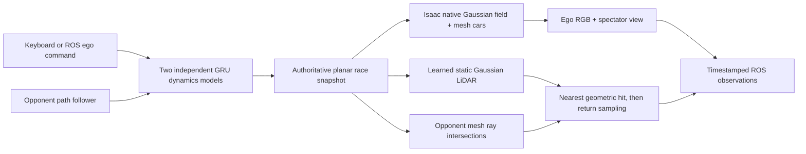

# F1Tenth racing with Gaussian sensors

The `racing/` application uses one fixed-step race state for two F1Tenth vehicles. Each vehicle has an independent Run30 GRU history. Isaac Sim 6 renders the learned Gaussian environment and detailed mesh cars together. A separate persistent GPU worker renders the learned static LiDAR field; GPU triangle intersections add the opponent before return dropout is sampled.



## Run

Keep `env_isaaclab` unchanged. Use the separate Isaac 6 environment prepared by `scripts/setup_isaac6.sh`. The launcher defaults to `~/miniconda3/envs/env_isaac6/bin/python`; override it with `RACING_ISAAC_PYTHON`. LiDAR uses `~/miniconda3/envs/roboracer/bin/python`, overridable with `--sensor-python`.

```bash
# Keyboard driving; SPACE starts from paused.
./scripts/run_racing.sh

# Both cars follow the reference route with learned dynamics.
./scripts/run_racing.sh --mode autopilot --autostart

# ROS 2 ego controller, built-in opponent. Add --scan for a height-filtered scan.
./scripts/run_racing.sh --ros --scan --mode ros --autostart

# Save native camera/viewport images, LiDAR points, trajectory and timing report.
./scripts/run_racing.sh --headless --mode autopilot --autostart \
  --steps 500 --output outputs/racing_validation

# Headless training: keep ego sensors, render spectator only for saved snapshots.
./scripts/run_racing.sh --headless --no-live-viewport --mode autopilot --autostart \
  --steps 2027 --visual-check --output outputs/racing_final_validation
```

Controls: **W/S** increase/decrease target speed, **A/D** steer, **SPACE** pause/resume, **M** manual, **T** ROS, **P** route follower, **R** reset. Limits are 2.5 m/s and 0.29 rad. Released steering returns to zero; speed is a target retained until changed. Reset pauses, clears histories and commands, and advances the episode ID. Vehicle or proxy-boundary contact ends the episode. There is no physical bounce and no second PhysX integration of the cars.

`--diagnostic-kinematic` explicitly selects a diagnostic bicycle model. It is never selected when a learned model fails. `--unpaced` measures maximum throughput; normal operation uses a shared pacing deadline so inexpensive dynamics steps recover time spent rendering sensor frames. The runtime reports achieved throughput separately from nominal simulation rates.

## Scenario and calibration

`configs/racing_142014.json` contains asset paths, native camera field-to-world Sim3, sensor mounts, spawns, path, collision proxy boundaries and rates. Its large model files remain external/ignored. The configured detailed vehicle is normalized uniformly to 42 cm length; its visual width is about 23.2 cm, within the 26 cm collision footprint.

Camera mounts map **optical RDF** (right/down/forward) into vehicle **FLU** (forward/left/up). LiDAR rays and published points use local FLU. World positions use metres, Z up; `world_base_z` places the planar vehicles in the recorded LiDAR map. USD camera rendering applies the explicit optical-to-OpenGL axis conversion. Gaussian positions and spherical harmonics remain in their original trained coordinates under a parent Sim3, avoiding an unrotated SH field after baking a frame rotation.

The 142014 alignment is **provisional**: 1,491 timestamp-paired camera centres produce mean residual **0.410 m**, median **0.389 m**, p95 **0.711 m**, maximum **0.856 m**. A global rigid/scale fit cannot remove reconstruction or odometry drift. This is larger than the vehicle and materially limits camera/LiDAR agreement and apparent placement relative to barriers. The route is a smoothed first recorded lap; its boundaries are a synthetic ±0.8 m corridor, **not measured physical walls**. The runtime integration is usable for development, but this asset calibration is not an accurate racing benchmark.

Reproduce the scenario (read-only source data, writes the selected JSON):

```bash
PYTHONPATH=. ~/miniconda3/envs/roboracer/bin/python -m racing.prepare_session \
  --vehicle-usd /path/to/F1TENTH.usd --output configs/racing_142014.json
```

A new environment needs a camera checkpoint, learned LiDAR checkpoint, their measured common-frame transform, calibrated sensor mounts, a closed path and reviewed collision boundaries. Reuse the vehicle dynamics model initially; validate and adapt it using driving data before claiming transfer. Camera conversion is cached with checkpoint and transform provenance; changing either regenerates the native USD. `--rebuild-assets` forces conversion. Conversion runs in a separate process to avoid mixing standalone and Isaac USD libraries.

Captured people or cars remain part of the static field unless cleaned during reconstruction. Removal volumes currently fail explicitly because removing an actor only from camera splats would leave a LiDAR ghost. Missing background behind a removed actor requires observations/retraining. The implementation does not invent replacement geometry.

## Sensor and ROS contract

Target rates: dynamics 50 Hz, camera 20 Hz, LiDAR 10 Hz, viewport 30 Hz. Camera samples lie on the dynamics clock, alternating 40/60 ms intervals; every message uses the actual snapshot time. The default LiDAR pattern is a procedural approximation of the existing Livox pattern, with a frozen pose per scan. It does not model within-scan motion distortion. The supplied 142014 checkpoint uses explicit `return_head: none`; return/drop head polarity must be selected explicitly for other checkpoints.

LiDAR face depth is converted from axial camera depth to metric ray range. Each ray retains identity, geometry, intensity and return probability. Fusion chooses the closest opaque geometric hit before sampling a return, so an opponent with a dropped return still blocks the background. Worker messages carry episode, sequence and simulation time; stale or mismatched replies are rejected. A sensor error pauses advancement instead of publishing stale observations.

ROS Humble runs in a separate sourced `/usr/bin/python3` process to avoid its Python 3.10 ABI conflicting with Isaac's Python 3.12. Images and points travel through shared memory, with bounded local control messages. The bridge requires `ackermann_msgs` in the Humble environment.

| Topic | Contract |
| --- | --- |
| `/ego/drive` | `ackermann_msgs/AckermannDriveStamped`, commanded speed and steering angle |
| `/clock` | Simulation time; reset begins a new epoch at zero |
| `/ego/camera/image_raw` | RGB8, `ego/camera_optical_frame` |
| `/ego/camera/camera_info` | Matching pinhole calibration |
| `/ego/lidar/points` | XYZI `PointCloud2`, `ego/lidar_link` |
| `/ego/scan` | Optional height-filtered projection of the hybrid point cloud |
| `/debug/ego/odom`, `/debug/opponent/odom` | Explicit ground truth for debugging |
| `/tf` | Namespaced vehicle and calibrated sensor frames |

Set ROS nodes to `use_sim_time`. Opponent pose is not fed into the ego perception API. Debug odometry and TF are ground truth and should not be inputs to a perception-only policy. ROS commands expire against monotonic wall time; repeated polling does not refresh their age.

The runtime publishes synchronized camera, LiDAR and odometry at time zero before waiting for the first ROS command. While waiting, it republishes fresh stationary observations for late DDS subscribers. A real Humble controller test received these initial observations, drove 25 steps to 0.5 seconds, and measured 0.132 m displacement (`outputs/racing_ros_validation/probe.json`).

## Validation

```bash
PYTHONNOUSERSITE=1 PYTEST_DISABLE_PLUGIN_AUTOLOAD=1 PYTHONPATH=. \
  ~/miniconda3/envs/roboracer/bin/python -m pytest tests -q

PYTHONNOUSERSITE=1 PYTHONPATH=. ~/miniconda3/envs/roboracer/bin/python \
  -m racing.verify --scenario configs/racing_142014.json --laps 3
```

The tests cover reset determinism, independent model histories, exclusive command modes, stale input, swept contacts including rotation, ray visibility/dropout, cubemap range, shared-memory cleanup and stale replies, mounting transforms, ROS payloads and asset scaling. GPU/Isaac checks require GPU and local IPC access.

Set `ROBORACER_TEST_ROS=1` when running pytest to include the installed Humble integration test. The complete suite passed 83 tests on this workstation on 2026-09-10.

Measured component checks on the RTX 4090: learned 142014 LiDAR has 669,253 Gaussians and renders 20,000 rays in about 10.6–11.2 ms after warm-up, or 11.3–12.2 ms through the worker. The 937,506-triangle vehicle takes about 0.8 ms per 20,000-ray GPU query. These are component timings; use the runtime's `report.json` for end-to-end speed. Two independent shipped GRUs completed three laps on the prepared 17.03 m proxy corridor, without contact; this does not validate transfer against real racing telemetry.

The full native pipeline also completed three laps per car (2,027 steps, 40.54 simulated seconds) with no contact or sensor fault. Headless execution with `--no-live-viewport` took 40.540 wall seconds: **1.000× real time**, 19.98 camera frames/s and 9.99 LiDAR scans/s. Loading, warm-up, visual probes and saved spectator screenshots are excluded. See `outputs/racing_final_validation/report.json` and `trajectory.jsonl`. Native visibility and controlled depth-ordering checks passed in the same run. This measures one two-car scene on the RTX 4090; it does not establish throughput for parallel training environments.

The final desktop application also completed 500 steps with the live spectator view and default Gaussian accumulation enabled: **0.635× real time**, 12.71 camera frames/s and 6.35 LiDAR scans/s measured against wall time (`outputs/racing_desktop_final/report.json`). Sensor timestamps retain the configured simulation rates. An earlier accumulation-disabled run reached 0.742× but produced more temporal noise. The saved native spectator frames were inspected; the desktop session was locked, so physical keyboard interaction was not exercised in this run. Keyboard state and arbitration are covered by automated tests.

`--visual-check` additionally saves opponent visibility/lighting comparisons, an opaque matte-material comparison and a controlled native Gaussian-wall occlusion experiment. The wall test hides the learned track temporarily, checks that a car behind an opaque Gaussian wall disappears, and checks that a car in front replaces the wall. It restores the real scene afterward. Failed visibility or depth-ordering checks exit with an error. These experiments verify renderer integration, not the quality of the learned track geometry or final appearance.

The renderer uses [RTX Real-Time 2.0's native particle fields](https://docs.omniverse.nvidia.com/materials-and-rendering/latest/particle-fields.html). An optional `camera_field.max_scale_m` export filter can remove oversized Gaussian axes; it is disabled by default. Testing a 0.3 m limit on this recording introduced holes and did not resolve opponent ghosting, so it is not used in the default scene.

Optional `camera_field.bake_world` bakes the Sim3 into Gaussian positions, covariance and degree-0–3 spherical harmonics. The default preserves the training frame under a parent transform. `rendering.gaussian_accumulation` defaults to true: disabling it increased temporal noise enough to fail the visibility signal-to-noise check. Both depth and albedo accumulation are assigned explicitly on startup to prevent persisted Kit settings changing the experiment. Accumulation improves stability but does not resolve the appearance issue.

**Visual quality remains unfinished.** The learned environment looks convincing at the capture-camera height, but the inserted vehicles appear washed out and partly transparent, and the higher spectator view exposes reconstruction artifacts. This was reproduced with a directly bound opaque magenta cube, while the same cube rendered solid with the learned field hidden. The native Gaussian/mesh interaction in this dense field therefore remains suspect; the exact renderer cause is unresolved. The exporter was checked against the checkpoint and native schema for positions, linear scales, opacity, normalized rotations and SH coefficients. A `rayHitDistance` sorting hint also failed to resolve it. An offline path-tracer probe with the same scene settings overexposed and was rejected. The application retains the real-time renderer.

Inspect `cube_scene.png` against `cube_only.png`, and `original_car.png` against `matte_car.png`, in the visual-check output. Passing the controlled wall experiment does **not** imply photorealistic opponents or correct compositing throughout this learned scene. This issue and the provisional calibration prevent treating the current camera observations as a validated perception-training benchmark.
