# Model evaluation: camera 3DGS, LiDAR 3DGS, vehicle dynamics
Generated 2026-09-10 21:16 on alienware-Alienware-Aurora-R15-AMD, commit `f138743`, torch 2.6.0+cu124, GPU NVIDIA GeForce RTX 4090.

Sections: camera model (renders vs recorded frames), LiDAR model (renders vs real scans), vehicle dynamics (GRU / Deep Dynamics / MS-NN vs MoCap and IMU). Every table is also in `summary.json`; per-frame numbers are in the CSV files next to this report.

## Key findings

**Camera 3DGS.** Held-out PSNR 2026-07-14 recording (splatfacto 50k): 27.6 dB (p10 26.1, SSIM 0.89, LPIPS 0.21); session 20260827_142014 (splatfacto): 27.0 dB (p10 24.7, SSIM 0.87, LPIPS 0.25); session 20260827_143212 (splatfacto): 27.4 dB (p10 24.0, SSIM 0.88, LPIPS 0.20); session 20260904_161841 (splatfacto): 27.7 dB (p10 25.5, SSIM 0.88, LPIPS 0.21). Range 27.0 to 27.7 dB on frames never seen in training; the worst tenth of each lap is 1.5 to 3.4 dB below the mean. See the novel-view panels for how far the camera may leave the recorded path.

**LiDAR 3DGS.** Against real held-out scans 2026-08-27 track A (142014) / lidar_3dgs_v1: Chamfer 23 cm, F@20cm 0.60, hit rate 0.88, median range error 38 cm; 2026-08-27 track A (142014) / lidar_3dgs_v8_5cmvoxel: Chamfer 24 cm, F@20cm 0.58, hit rate 0.95, median range error 40 cm; 2026-08-27 track B (143212) / lidar_3dgs_v1: Chamfer 16 cm, F@20cm 0.75, hit rate 0.81, median range error 22 cm; 2026-08-27 track B (143212) / lidar_3dgs_v8_5cmvoxel: Chamfer 17 cm, F@20cm 0.74, hit rate 0.89, median range error 23 cm. Best: 2026-08-27 track B (143212) / lidar_3dgs_v1. Only 15 to 30 % of matched rays are within 10 cm of the real return, so the models reproduce the track layout, not sensor-grade geometry (FAST-LIO pose error included).

**Dynamics.** Lowest one-step yaw-rate error per dataset: day1_test_crossday: GRU run38 sched.sampling (0.231 rad/s); day2_val: GRU run38 sched.sampling (0.233 rad/s); day3_val_sameday: GRU run38 sched.sampling (0.180 rad/s); newtrack_20260827: GRU run38 sched.sampling (0.095 rad/s). Models beating the persistence baseline on every dataset: GRU run38 sched.sampling. Autoregressive yaw-rate error after 2 s ranges 0.21 to 0.92 rad/s across models and datasets. Deployed GRU, 60 s closed loop, 3-channel RMSE: day3_val_sameday: 0.22; day2_val: 0.38; day1_test_crossday: 0.34; newtrack_20260827: 0.43.

**MS-NN.** Same-day one-step yaw rate [rad/s] MS-NN exp9 phase2 (deployed): 0.140 vs persistence 0.110; MS-NN a1 wide-margin phase2: 0.145 vs persistence 0.110; MS-NN a2 phase3 lower-lr: 0.141 vs persistence 0.110. Scored against the next IMU sample, yaw-rate error is 1.27 to 2.17x persistence and a_x 2.4 to 3.1x across all datasets (the original notes compared with the current sample, which gives 1.05x).

**Data.** IMU yaw-rate column biased by +2.00 rad/s in session_20260722_115055_seg2_20ms.csv (7 of 29 processed CSVs show such a constant offset; MoCap columns are fine). IMU-based training or evaluation on those files is compromised.

## Camera model (3D Gaussian Splatting)

Renders are produced by the same renderer the Isaac Sim camera server uses and compared with the recorded, undistorted frames. Eval frames are the ones nerfstudio held out during training (10 %, deterministic split); train frames are shown for reference. LPIPS uses AlexNet (lower is better).

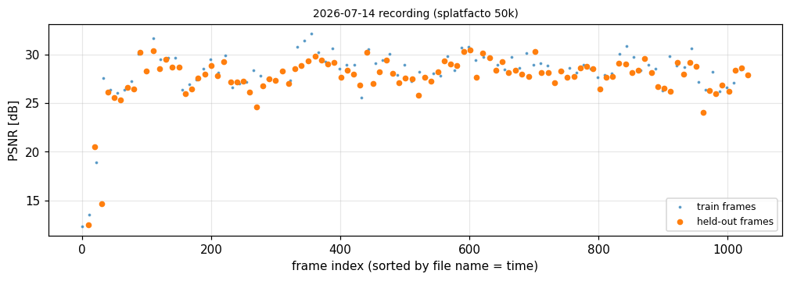

*2026-07-14 recording (splatfacto 50k): PSNR along the recording. Dips mark parts of the track the model reconstructs worse.*

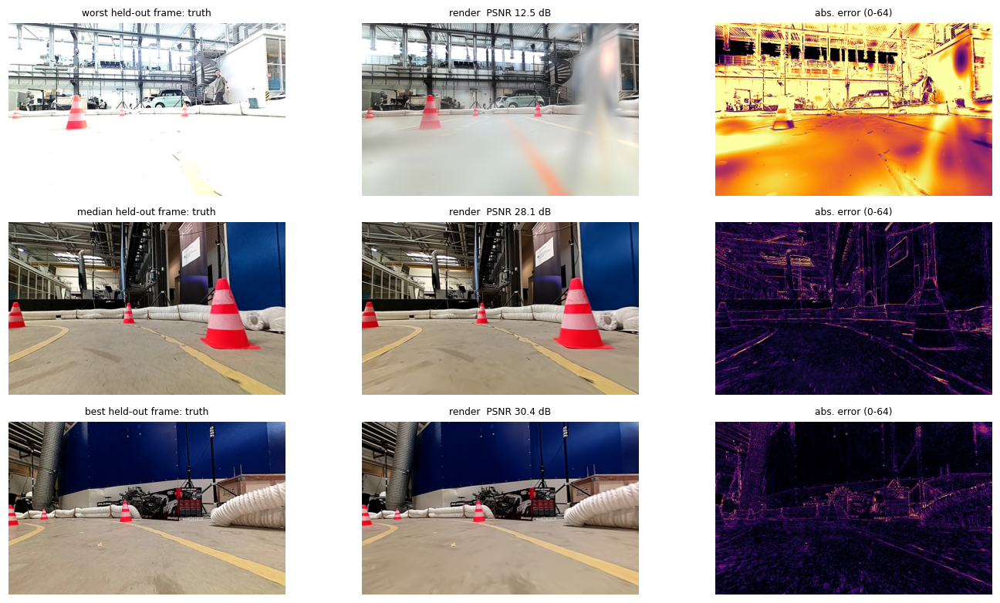

*2026-07-14 recording (splatfacto 50k): worst / median / best held-out frames.*

*2026-07-14 recording (splatfacto 50k): renders at poses the car never visited. 'sharp' = Laplacian variance relative to the on-trajectory render: well below 1 = blur, well above 1 = high-frequency floaters/streaks; both mean the model is being used outside the poses it learned from. Judge the images.*

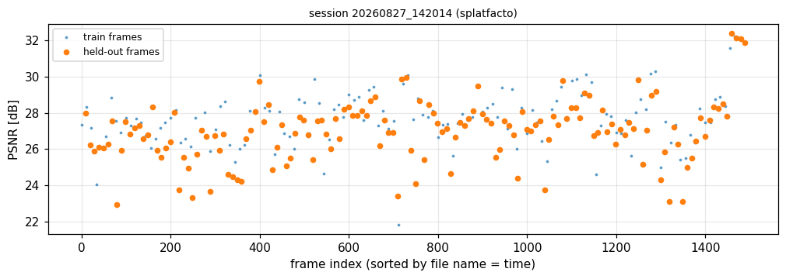

*session 20260827_142014 (splatfacto): PSNR along the recording. Dips mark parts of the track the model reconstructs worse.*

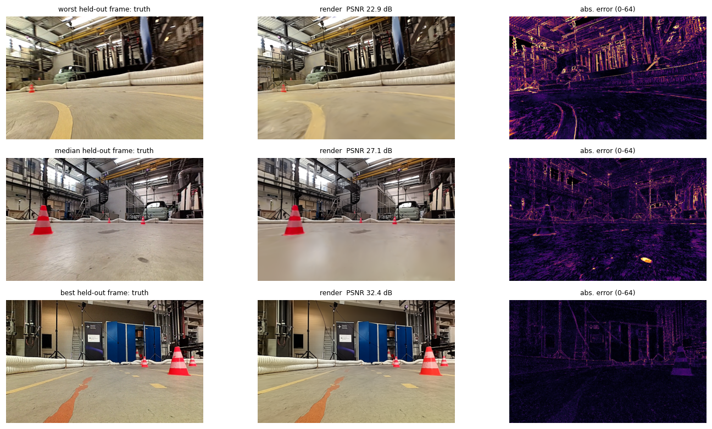

*session 20260827_142014 (splatfacto): worst / median / best held-out frames.*

*session 20260827_142014 (splatfacto): renders at poses the car never visited. 'sharp' = Laplacian variance relative to the on-trajectory render: well below 1 = blur, well above 1 = high-frequency floaters/streaks; both mean the model is being used outside the poses it learned from. Judge the images.*

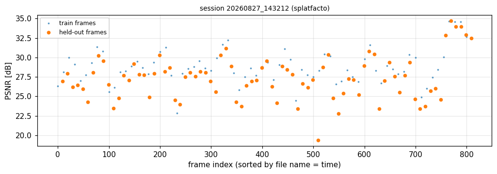

*session 20260827_143212 (splatfacto): PSNR along the recording. Dips mark parts of the track the model reconstructs worse.*

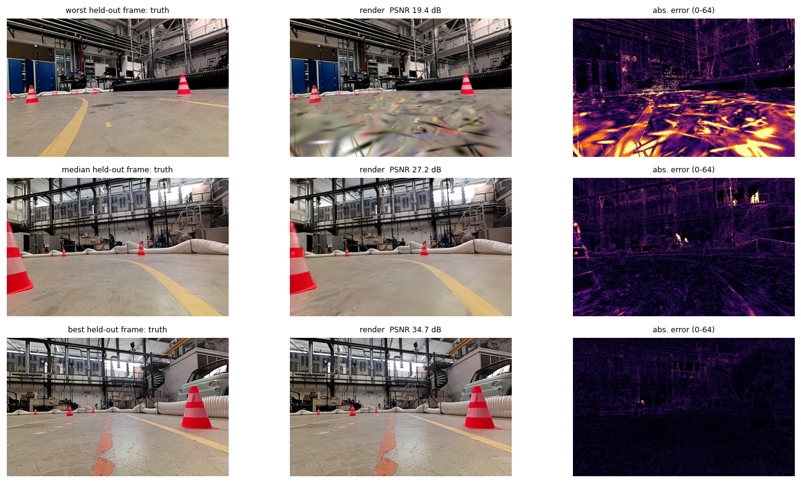

*session 20260827_143212 (splatfacto): worst / median / best held-out frames.*

*session 20260827_143212 (splatfacto): renders at poses the car never visited. 'sharp' = Laplacian variance relative to the on-trajectory render: well below 1 = blur, well above 1 = high-frequency floaters/streaks; both mean the model is being used outside the poses it learned from. Judge the images.*

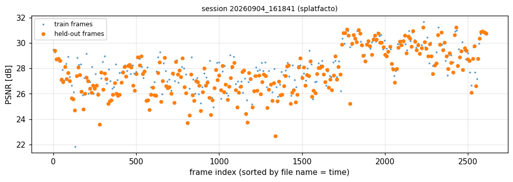

*session 20260904_161841 (splatfacto): PSNR along the recording. Dips mark parts of the track the model reconstructs worse.*

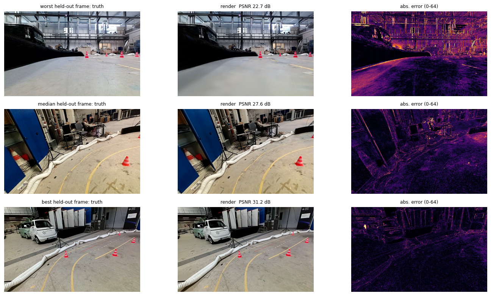

*session 20260904_161841 (splatfacto): worst / median / best held-out frames.*

*session 20260904_161841 (splatfacto): renders at poses the car never visited. 'sharp' = Laplacian variance relative to the on-trajectory render: well below 1 = blur, well above 1 = high-frequency floaters/streaks; both mean the model is being used outside the poses it learned from. Judge the images.*

### Summary (held-out frames)

| model | n eval | PSNR mean [dB] | PSNR p10 | SSIM | LPIPS | PSNR train frames | reported PSNR | render [ms] |
|---|---|---|---|---|---|---|---|---|
| 2026-07-14 recording (splatfacto 50k) | 103 | 27.62 | 26.11 | 0.888 | 0.2096 | 28.14 | 27.61 | 7.298 |
| session 20260827_142014 (splatfacto) | 149 | 27 | 24.66 | 0.8679 | 0.2541 | 27.72 | 27.01 | 5.266 |
| session 20260827_143212 (splatfacto) | 81 | 27.36 | 23.97 | 0.8785 | 0.203 | 28.77 | 27.36 | 5.486 |
| session 20260904_161841 (splatfacto) | 261 | 27.71 | 25.51 | 0.8845 | 0.211 | 28.16 | nan | 4.848 |

Reported PSNR = number in the original package / ns-eval logs, for a consistency check. The p10 column (10th percentile) tells how bad the worst tenth of the lap looks; a large gap between train and eval PSNR would indicate overfitting to the training frames.

## LiDAR model (LiDAR 3D Gaussian Splatting)

The LiDAR model is a Gaussian-splat scene rendered through a 6-face cubemap and read back along the Livox scan pattern. Chamfer distance is the mean nearest-neighbour distance between real and rendered scan (both directions); F-score is the harmonic mean of precision and recall at a distance threshold; hit rate is the share of real rays for which the model returns a surface.

### 2026-07-14 model

> No raw LiDAR recording of the 2026-07-14 session is available locally, so this model cannot be scored against real scans here (the 13.44 cm Chamfer in the original notes was computed on the training machine). The shipped synthetic/real hold-out clouds cover different regions and are not a valid pair for a set distance; skipped.

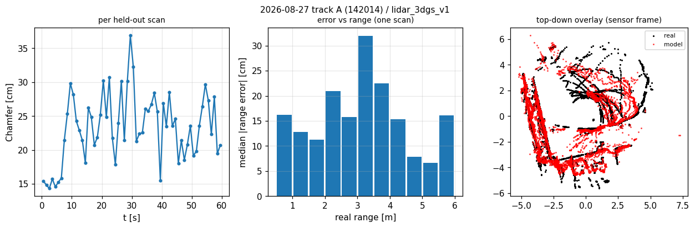

*2026-08-27 track A (142014) / lidar_3dgs_v1: Chamfer over the lap, range error vs distance, and a real vs rendered scan.*

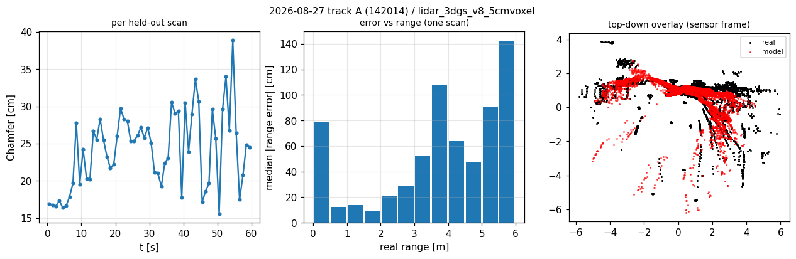

*2026-08-27 track A (142014) / lidar_3dgs_v8_5cmvoxel: Chamfer over the lap, range error vs distance, and a real vs rendered scan.*

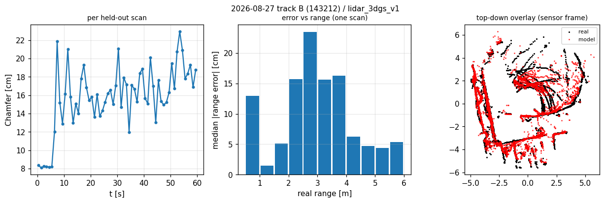

*2026-08-27 track B (143212) / lidar_3dgs_v1: Chamfer over the lap, range error vs distance, and a real vs rendered scan.*

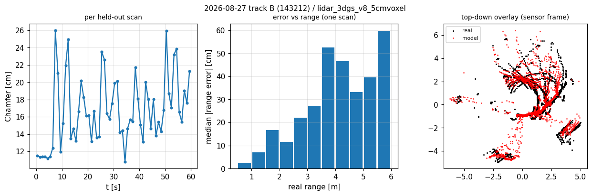

*2026-08-27 track B (143212) / lidar_3dgs_v8_5cmvoxel: Chamfer over the lap, range error vs distance, and a real vs rendered scan.*

### Session models vs real held-out scans

| model | scans | hit rate | median |Δrange| [cm] | RMSE range [cm] | within 10 cm | Chamfer [cm] | F@10cm | F@20cm |
|---|---|---|---|---|---|---|---|---|
| 2026-08-27 track A (142014) / lidar_3dgs_v1 | 60 | 0.8752 | 37.53 | 92.89 | 0.1671 | 23.27 | 0.3251 | 0.6027 |
| 2026-08-27 track A (142014) / lidar_3dgs_v8_5cmvoxel | 60 | 0.9542 | 40.18 | 99.88 | 0.1531 | 24.14 | 0.3075 | 0.5762 |
| 2026-08-27 track B (143212) / lidar_3dgs_v1 | 60 | 0.8106 | 21.87 | 74.65 | 0.3035 | 15.85 | 0.4915 | 0.7511 |
| 2026-08-27 track B (143212) / lidar_3dgs_v8_5cmvoxel | 60 | 0.8928 | 22.81 | 81.04 | 0.2884 | 16.76 | 0.4772 | 0.7354 |

Poses come from FAST-LIO odometry of the same recording, so pose error is part of the number. Hit rate below 1 means the model has holes where the real sensor saw a surface (or the alpha filter removed thin geometry); range errors are measured only on rays both agree on.

## Vehicle dynamics

Models predict the next 20 ms sample of the vehicle state from a history window of true (or, in rollouts, predicted) states and the commanded speed/steering. Errors are RMSE against MoCap ground truth (GRU, Deep Dynamics) or IMU/VESC ground truth (MS-NN). Persistence = repeating the last observed value.

| dataset | rows | duration [s] | mean speed [m/s] | description |
|---|---|---|---|---|
| day3_val_sameday | 2167 | 43.34 | 2.268 | Day 3, racing section (same day/track as training) |
| day2_val | 5242 | 104.8 | 1.507 | Day 2 validation segment |
| day1_test_crossday | 6304 | 126.1 | 1.44 | Day 1, held-out test day |
| newtrack_20260827 | 775 | 15.5 | 1.723 | New track 2026-08-27, validation split |

### Data sanity: IMU yaw rate vs MoCap yaw rate

| dataset | file | mean(IMU - MoCap) [rad/s] | RMSE [rad/s] | |IMU| while standing | flag |
|---|---|---|---|---|---|
| day3_val_sameday | session_20260728_163324_seg1_20ms.csv | -0.02029 | 0.4818 | nan | ok |
| day2_val | session_20260722_115055_seg2_20ms.csv | 1.995 | 2.119 | 1.985 | BIASED |
| day2_val (MS-NN file) | session_20260722_115055_seg1_20ms.csv | -0.0002842 | 0.5854 | 0.0002436 | ok |
| day1_test_crossday | session_20260721_20ms.csv | -0.0005355 | 0.7803 | 0.003536 | ok |
| newtrack_20260827 | session_20260827_143212_val_20ms.csv | -0.0009678 | 0.07251 | nan | ok |

A non-zero gyro reading while the car stands still is a sensor/processing bias in that CSV, not a model error. Across all 29 processed CSVs, 7 segments show a constant bias of 0.7 to 2.0 rad/s (e.g. 20260722_115055 seg2, 20260722_113922 seg3, 20260728_164746 seg2); MoCap-based columns are unaffected.

Models: **GRU run30 (deployed)** (GRU h=100 L=1, in=7 out=5); **GRU run38 sched.sampling** (GRU h=100 L=1, in=7 out=5); **GRU run39 h200** (GRU h=200 L=1, in=7 out=5); **GRU run40 2-layer** (GRU h=100 L=2, in=7 out=5); **GRU 0731 IMU-ax/a_y_corr** (GRU h=100 L=1, in=7 out=5); **Deep Dynamics v8** (Deep Dynamics v8 (6 Pacejka params, GRU h=64 L=2))

### One-step open-loop RMSE (model | persistence baseline)

| model | dataset | v_x [m/s] | persist | v_y [m/s] | persist | yaw rate [rad/s] | persist |
|---|---|---|---|---|---|---|---|
| GRU run30 (deployed) | day3_val_sameday | 0.1023 | 0.005068 | 0.08611 | 0.008278 | 0.279 | 0.222 |
| GRU run38 sched.sampling | day3_val_sameday | 0.1387 | 0.005068 | 0.06944 | 0.008278 | 0.1805 | 0.222 |
| GRU run39 h200 | day3_val_sameday | 0.1574 | 0.005068 | 0.1475 | 0.008278 | 0.3212 | 0.222 |
| GRU run40 2-layer | day3_val_sameday | 0.123 | 0.005068 | 0.06454 | 0.008278 | 0.2928 | 0.222 |
| GRU 0731 IMU-ax/a_y_corr | day3_val_sameday | 0.08355 | 0.005068 | 0.1053 | 0.008278 | 0.3017 | 0.222 |
| Deep Dynamics v8 | day3_val_sameday | 0.04206 | 0.005068 | 0.07995 | 0.008278 | 0.2691 | 0.222 |
| GRU run30 (deployed) | day2_val | 0.2968 | 0.02951 | 0.2769 | 0.01776 | 0.5834 | 0.2781 |
| GRU run38 sched.sampling | day2_val | 0.1464 | 0.02951 | 0.1045 | 0.01776 | 0.233 | 0.2781 |
| GRU run39 h200 | day2_val | 0.3087 | 0.02951 | 0.301 | 0.01776 | 0.654 | 0.2781 |
| GRU run40 2-layer | day2_val | 0.2182 | 0.02951 | 0.2185 | 0.01776 | 0.6426 | 0.2781 |
| GRU 0731 IMU-ax/a_y_corr | day2_val | 0.3392 | 0.02951 | 0.2344 | 0.01776 | 0.6356 | 0.2781 |
| Deep Dynamics v8 | day2_val | 0.04019 | 0.02951 | 0.0612 | 0.01776 | 0.2866 | 0.2781 |
| GRU run30 (deployed) | day1_test_crossday | 0.2944 | 0.0345 | 0.2078 | 0.01463 | 0.5683 | 0.2896 |
| GRU run38 sched.sampling | day1_test_crossday | 0.1709 | 0.0345 | 0.08998 | 0.01463 | 0.2307 | 0.2896 |
| GRU run39 h200 | day1_test_crossday | 0.3305 | 0.0345 | 0.2352 | 0.01463 | 0.5983 | 0.2896 |
| GRU run40 2-layer | day1_test_crossday | 0.2378 | 0.0345 | 0.1805 | 0.01463 | 0.6306 | 0.2896 |
| GRU 0731 IMU-ax/a_y_corr | day1_test_crossday | 0.2875 | 0.0345 | 0.1403 | 0.01463 | 0.5688 | 0.2896 |
| Deep Dynamics v8 | day1_test_crossday | 0.03934 | 0.0345 | 0.05766 | 0.01463 | 0.3928 | 0.2896 |
| GRU run30 (deployed) | newtrack_20260827 | 0.182 | 0.01202 | 0.2223 | 0.001073 | 0.1896 | 0.1167 |
| GRU run38 sched.sampling | newtrack_20260827 | 0.06469 | 0.01202 | 0.0659 | 0.001073 | 0.09526 | 0.1167 |
| GRU run39 h200 | newtrack_20260827 | 0.1974 | 0.01202 | 0.2047 | 0.001073 | 0.2082 | 0.1167 |
| GRU run40 2-layer | newtrack_20260827 | 0.1771 | 0.01202 | 0.1584 | 0.001073 | 0.1854 | 0.1167 |
| GRU 0731 IMU-ax/a_y_corr | newtrack_20260827 | 0.1506 | 0.01202 | 0.1463 | 0.001073 | 0.1904 | 0.1167 |
| Deep Dynamics v8 | newtrack_20260827 | 0.01508 | 0.01202 | 0.04003 | 0.001073 | 0.1991 | 0.1167 |

### Autoregressive rollout: yaw-rate RMSE vs horizon [rad/s]

| model | dataset | 0.1s | 0.2s | 0.5s | 1.0s | 2.0s |
|---|---|---|---|---|---|---|
| GRU run30 (deployed) | day3_val_sameday | 0.4396 | 0.3504 | 0.3849 | 0.3858 | 0.3836 |
| GRU run38 sched.sampling | day3_val_sameday | 0.2765 | 0.246 | 0.3446 | 0.3677 | 0.3783 |
| GRU run39 h200 | day3_val_sameday | 0.4494 | 0.4326 | 0.392 | 0.3747 | 0.3655 |
| GRU run40 2-layer | day3_val_sameday | 0.4876 | 0.4003 | 0.383 | 0.3759 | 0.3721 |
| GRU 0731 IMU-ax/a_y_corr | day3_val_sameday | 0.3941 | 0.3387 | 0.3844 | 0.3763 | 0.3727 |
| Deep Dynamics v8 | day3_val_sameday | 1.207 | 1.252 | 0.9523 | 0.8221 | 0.7579 |
| GRU run30 (deployed) | day2_val | 0.6469 | 0.7285 | 0.6877 | 0.7067 | 0.7158 |
| GRU run38 sched.sampling | day2_val | 0.5293 | 0.6872 | 0.6717 | 0.7056 | 0.7229 |
| GRU run39 h200 | day2_val | 0.7347 | 0.8052 | 0.7223 | 0.7167 | 0.718 |
| GRU run40 2-layer | day2_val | 0.7135 | 0.7718 | 0.7154 | 0.7237 | 0.7283 |
| GRU 0731 IMU-ax/a_y_corr | day2_val | 0.7861 | 0.8667 | 0.8215 | 0.7888 | 0.7684 |
| Deep Dynamics v8 | day2_val | 0.7174 | 0.8919 | 0.8631 | 0.858 | 0.8668 |
| GRU run30 (deployed) | day1_test_crossday | 0.5692 | 0.6469 | 0.7309 | 0.7302 | 0.74 |
| GRU run38 sched.sampling | day1_test_crossday | 0.518 | 0.6344 | 0.7357 | 0.7531 | 0.7632 |
| GRU run39 h200 | day1_test_crossday | 0.6635 | 0.684 | 0.7508 | 0.7478 | 0.7468 |
| GRU run40 2-layer | day1_test_crossday | 0.5866 | 0.6563 | 0.7262 | 0.7344 | 0.7414 |
| GRU 0731 IMU-ax/a_y_corr | day1_test_crossday | 0.552 | 0.6337 | 0.7419 | 0.7493 | 0.758 |
| Deep Dynamics v8 | day1_test_crossday | 0.8973 | 1.023 | 1.001 | 0.9406 | 0.9244 |
| GRU run30 (deployed) | newtrack_20260827 | 0.2366 | 0.2215 | 0.2295 | 0.2235 | 0.2211 |
| GRU run38 sched.sampling | newtrack_20260827 | 0.1842 | 0.1779 | 0.2948 | 0.3499 | 0.3799 |
| GRU run39 h200 | newtrack_20260827 | 0.3037 | 0.302 | 0.3198 | 0.3 | 0.2553 |
| GRU run40 2-layer | newtrack_20260827 | 0.2086 | 0.1911 | 0.2188 | 0.2105 | 0.2073 |
| GRU 0731 IMU-ax/a_y_corr | newtrack_20260827 | 0.196 | 0.2316 | 0.7138 | 0.7755 | 0.6238 |
| Deep Dynamics v8 | newtrack_20260827 | 0.1868 | 0.4757 | 0.6387 | 0.6485 | 0.6758 |

### Autoregressive rollout: v_x RMSE vs horizon [m/s]

| model | dataset | 0.1s | 0.2s | 0.5s | 1.0s | 2.0s |
|---|---|---|---|---|---|---|
| GRU run30 (deployed) | day3_val_sameday | 0.06338 | 0.05191 | 0.04705 | 0.04441 | 0.04283 |
| GRU run38 sched.sampling | day3_val_sameday | 0.103 | 0.09253 | 0.08363 | 0.07975 | 0.07776 |
| GRU run39 h200 | day3_val_sameday | 0.08819 | 0.07313 | 0.06383 | 0.05955 | 0.05691 |
| GRU run40 2-layer | day3_val_sameday | 0.07021 | 0.05789 | 0.0507 | 0.04776 | 0.04558 |
| GRU 0731 IMU-ax/a_y_corr | day3_val_sameday | 0.06313 | 0.06118 | 0.0569 | 0.05431 | 0.05272 |
| Deep Dynamics v8 | day3_val_sameday | 0.1186 | 0.1752 | 0.2164 | 0.2172 | 0.2114 |
| GRU run30 (deployed) | day2_val | 0.1923 | 0.1854 | 0.2453 | 0.3189 | 0.3601 |
| GRU run38 sched.sampling | day2_val | 0.1705 | 0.1823 | 0.2508 | 0.3534 | 0.4094 |
| GRU run39 h200 | day2_val | 0.2055 | 0.2002 | 0.253 | 0.3168 | 0.3573 |
| GRU run40 2-layer | day2_val | 0.1805 | 0.1873 | 0.253 | 0.3208 | 0.3579 |
| GRU 0731 IMU-ax/a_y_corr | day2_val | 0.3191 | 0.3317 | 0.3923 | 0.4192 | 0.4339 |
| Deep Dynamics v8 | day2_val | 0.1323 | 0.2213 | 0.3553 | 0.462 | 0.5291 |
| GRU run30 (deployed) | day1_test_crossday | 0.1876 | 0.2047 | 0.3232 | 0.3698 | 0.3853 |
| GRU run38 sched.sampling | day1_test_crossday | 0.2049 | 0.2173 | 0.303 | 0.3801 | 0.4422 |
| GRU run39 h200 | day1_test_crossday | 0.2075 | 0.2069 | 0.3324 | 0.3898 | 0.4014 |
| GRU run40 2-layer | day1_test_crossday | 0.2199 | 0.2158 | 0.3242 | 0.3612 | 0.3712 |
| GRU 0731 IMU-ax/a_y_corr | day1_test_crossday | 0.215 | 0.2409 | 0.374 | 0.417 | 0.437 |
| Deep Dynamics v8 | day1_test_crossday | 0.1143 | 0.1988 | 0.4015 | 0.5158 | 0.5585 |
| GRU run30 (deployed) | newtrack_20260827 | 0.1178 | 0.1169 | 0.1463 | 0.1425 | 0.154 |
| GRU run38 sched.sampling | newtrack_20260827 | 0.07749 | 0.09681 | 0.1439 | 0.161 | 0.1678 |
| GRU run39 h200 | newtrack_20260827 | 0.1205 | 0.1244 | 0.1499 | 0.1429 | 0.1481 |
| GRU run40 2-layer | newtrack_20260827 | 0.1257 | 0.1219 | 0.1646 | 0.1697 | 0.1799 |
| GRU 0731 IMU-ax/a_y_corr | newtrack_20260827 | 0.1109 | 0.1288 | 0.1571 | 0.1745 | 0.2033 |
| Deep Dynamics v8 | newtrack_20260827 | 0.0382 | 0.07482 | 0.09719 | 0.1233 | 0.1433 |

### Full autoregressive rollout (warm-up 10 steps, then closed loop)

| model | dataset | tier | length [s] | RMSE 3ch (v_x,v_y,yaw) | RMSE 5ch |
|---|---|---|---|---|---|
| GRU run30 (deployed) | day3_val_sameday | 60s | 43.12 | 0.2228 | 0.2255 |
| GRU run30 (deployed) | day3_val_sameday | 125s | 43.12 | 0.2228 | 0.2255 |
| GRU run38 sched.sampling | day3_val_sameday | 60s | 43.12 | 0.2299 | 0.2829 |
| GRU run38 sched.sampling | day3_val_sameday | 125s | 43.12 | 0.2299 | 0.2829 |
| GRU run39 h200 | day3_val_sameday | 60s | 43.12 | 0.2094 | 0.2255 |
| GRU run39 h200 | day3_val_sameday | 125s | 43.12 | 0.2094 | 0.2255 |
| GRU run40 2-layer | day3_val_sameday | 60s | 43.12 | 0.214 | 0.2292 |
| GRU run40 2-layer | day3_val_sameday | 125s | 43.12 | 0.214 | 0.2292 |
| GRU 0731 IMU-ax/a_y_corr | day3_val_sameday | 60s | 43.12 | 0.2194 | 0.4552 |
| GRU 0731 IMU-ax/a_y_corr | day3_val_sameday | 125s | 43.12 | 0.2194 | 0.4552 |
| Deep Dynamics v8 | day3_val_sameday | 60s | 43.12 | 0.6837 | 0.6837 |
| Deep Dynamics v8 | day3_val_sameday | 125s | 43.12 | 0.6837 | 0.6837 |
| GRU run30 (deployed) | day2_val | 60s | 60 | 0.3797 | 0.4951 |
| GRU run30 (deployed) | day2_val | 125s | 104.6 | 0.5044 | 0.8661 |
| GRU run38 sched.sampling | day2_val | 60s | 60 | 0.37 | 0.5253 |
| GRU run38 sched.sampling | day2_val | 125s | 104.6 | 0.5661 | 0.9575 |
| GRU run39 h200 | day2_val | 60s | 60 | 0.3492 | 0.4851 |
| GRU run39 h200 | day2_val | 125s | 104.6 | 0.5089 | 0.8742 |
| GRU run40 2-layer | day2_val | 60s | 60 | 0.3985 | 0.5193 |
| GRU run40 2-layer | day2_val | 125s | 104.6 | 0.5162 | 0.865 |
| GRU 0731 IMU-ax/a_y_corr | day2_val | 60s | 60 | 0.4219 | 2.26 |
| GRU 0731 IMU-ax/a_y_corr | day2_val | 125s | 104.6 | 0.588 | 2.539 |
| Deep Dynamics v8 | day2_val | 60s | 60 | 0.6917 | 0.6917 |
| Deep Dynamics v8 | day2_val | 125s | 104.6 | 0.7323 | 0.7323 |
| GRU run30 (deployed) | day1_test_crossday | 60s | 60 | 0.3391 | 0.4464 |
| GRU run30 (deployed) | day1_test_crossday | 125s | 125 | 0.509 | 0.9244 |
| GRU run38 sched.sampling | day1_test_crossday | 60s | 60 | 0.4793 | 0.7633 |
| GRU run38 sched.sampling | day1_test_crossday | 125s | 125 | 0.6353 | 1.089 |
| GRU run39 h200 | day1_test_crossday | 60s | 60 | 0.327 | 0.4391 |
| GRU run39 h200 | day1_test_crossday | 125s | 125 | 0.5057 | 0.9374 |
| GRU run40 2-layer | day1_test_crossday | 60s | 60 | 0.3444 | 0.4577 |
| GRU run40 2-layer | day1_test_crossday | 125s | 125 | 0.5111 | 0.9327 |
| GRU 0731 IMU-ax/a_y_corr | day1_test_crossday | 60s | 60 | 0.3682 | 0.8285 |
| GRU 0731 IMU-ax/a_y_corr | day1_test_crossday | 125s | 125 | 0.5277 | 1.15 |
| Deep Dynamics v8 | day1_test_crossday | 60s | 60 | 0.5785 | 0.5785 |
| Deep Dynamics v8 | day1_test_crossday | 125s | 125 | 0.6653 | 0.6653 |
| GRU run30 (deployed) | newtrack_20260827 | 60s | 15.28 | 0.4316 | 0.4902 |
| GRU run30 (deployed) | newtrack_20260827 | 125s | 15.28 | 0.4316 | 0.4902 |
| GRU run38 sched.sampling | newtrack_20260827 | 60s | 15.28 | 0.5468 | 0.6698 |
| GRU run38 sched.sampling | newtrack_20260827 | 125s | 15.28 | 0.5468 | 0.6698 |
| GRU run39 h200 | newtrack_20260827 | 60s | 15.28 | 0.3338 | 0.3914 |
| GRU run39 h200 | newtrack_20260827 | 125s | 15.28 | 0.3338 | 0.3914 |
| GRU run40 2-layer | newtrack_20260827 | 60s | 15.28 | 0.3951 | 0.449 |
| GRU run40 2-layer | newtrack_20260827 | 125s | 15.28 | 0.3951 | 0.449 |
| GRU 0731 IMU-ax/a_y_corr | newtrack_20260827 | 60s | 15.28 | 0.4829 | 2.251 |
| GRU 0731 IMU-ax/a_y_corr | newtrack_20260827 | 125s | 15.28 | 0.4829 | 2.251 |
| Deep Dynamics v8 | newtrack_20260827 | 60s | 15.28 | 0.4071 | 0.4071 |
| Deep Dynamics v8 | newtrack_20260827 | 125s | 15.28 | 0.4071 | 0.4071 |

### Pose drift after integrating predicted body velocities

| model | dataset | median drift @1 s [m] | median drift @2 s [m] | drift @2 s [% of path] |
|---|---|---|---|---|
| GRU run30 (deployed) | day3_val_sameday | 0.06496 | 0.1591 | 3.021 |
| GRU run38 sched.sampling | day3_val_sameday | 0.1413 | 0.3112 | 6.225 |
| GRU run39 h200 | day3_val_sameday | 0.1049 | 0.2033 | 4.207 |
| GRU run40 2-layer | day3_val_sameday | 0.09552 | 0.2084 | 4.238 |
| GRU 0731 IMU-ax/a_y_corr | day3_val_sameday | 0.1164 | 0.2654 | 5.394 |
| Deep Dynamics v8 | day3_val_sameday | 0.7098 | 1.197 | 24.09 |
| GRU run30 (deployed) | day2_val | 0.1426 | 0.2974 | 11.17 |
| GRU run38 sched.sampling | day2_val | 0.1569 | 0.3873 | 12.89 |
| GRU run39 h200 | day2_val | 0.1585 | 0.3286 | 12.39 |
| GRU run40 2-layer | day2_val | 0.1673 | 0.3675 | 12.48 |
| GRU 0731 IMU-ax/a_y_corr | day2_val | 0.3458 | 0.766 | 24.97 |
| Deep Dynamics v8 | day2_val | 0.5509 | 1.062 | 32.81 |
| GRU run30 (deployed) | day1_test_crossday | 0.1981 | 0.4348 | 17.83 |
| GRU run38 sched.sampling | day1_test_crossday | 0.1607 | 0.3617 | 14.17 |
| GRU run39 h200 | day1_test_crossday | 0.1665 | 0.3816 | 16.34 |
| GRU run40 2-layer | day1_test_crossday | 0.1704 | 0.394 | 17.54 |
| GRU 0731 IMU-ax/a_y_corr | day1_test_crossday | 0.1533 | 0.347 | 13.86 |
| Deep Dynamics v8 | day1_test_crossday | 0.3568 | 0.8554 | 30.11 |
| GRU run30 (deployed) | newtrack_20260827 | 0.2981 | 0.4879 | 15.5 |
| GRU run38 sched.sampling | newtrack_20260827 | 0.09993 | 0.2195 | 6.916 |
| GRU run39 h200 | newtrack_20260827 | 0.2433 | 0.5013 | 16.46 |
| GRU run40 2-layer | newtrack_20260827 | 0.3349 | 0.7071 | 20.63 |
| GRU 0731 IMU-ax/a_y_corr | newtrack_20260827 | 0.1652 | 0.3276 | 8.674 |
| Deep Dynamics v8 | newtrack_20260827 | 0.1808 | 0.5227 | 23.18 |

### One-step yaw-rate RMSE by speed bin [rad/s]

| model | dataset | |v_x| bin [m/s] | n | RMSE |
|---|---|---|---|---|
| GRU run30 (deployed) | day3_val_sameday | 1.5-2.0 | 310 | 0.2006 |
| GRU run30 (deployed) | day3_val_sameday | 2.0-2.5 | 1410 | 0.308 |
| GRU run30 (deployed) | day3_val_sameday | 2.5-4.0 | 437 | 0.2225 |
| GRU run38 sched.sampling | day3_val_sameday | 1.5-2.0 | 310 | 0.1232 |
| GRU run38 sched.sampling | day3_val_sameday | 2.0-2.5 | 1410 | 0.1604 |
| GRU run38 sched.sampling | day3_val_sameday | 2.5-4.0 | 437 | 0.2587 |
| GRU run39 h200 | day3_val_sameday | 1.5-2.0 | 310 | 0.2463 |
| GRU run39 h200 | day3_val_sameday | 2.0-2.5 | 1410 | 0.3537 |
| GRU run39 h200 | day3_val_sameday | 2.5-4.0 | 437 | 0.2503 |
| GRU run40 2-layer | day3_val_sameday | 1.5-2.0 | 310 | 0.2283 |
| GRU run40 2-layer | day3_val_sameday | 2.0-2.5 | 1410 | 0.338 |
| GRU run40 2-layer | day3_val_sameday | 2.5-4.0 | 437 | 0.1329 |
| GRU 0731 IMU-ax/a_y_corr | day3_val_sameday | 1.5-2.0 | 310 | 0.2124 |
| GRU 0731 IMU-ax/a_y_corr | day3_val_sameday | 2.0-2.5 | 1410 | 0.3514 |
| GRU 0731 IMU-ax/a_y_corr | day3_val_sameday | 2.5-4.0 | 437 | 0.1365 |
| Deep Dynamics v8 | day3_val_sameday | 1.5-2.0 | 310 | 0.2063 |
| Deep Dynamics v8 | day3_val_sameday | 2.0-2.5 | 1410 | 0.2804 |
| Deep Dynamics v8 | day3_val_sameday | 2.5-4.0 | 437 | 0.2715 |
| GRU run30 (deployed) | day2_val | 0.0-0.5 | 852 | 0.6282 |
| GRU run30 (deployed) | day2_val | 0.5-1.0 | 623 | 0.8533 |
| GRU run30 (deployed) | day2_val | 1.0-1.5 | 970 | 0.5497 |
| GRU run30 (deployed) | day2_val | 1.5-2.0 | 1060 | 0.4279 |
| GRU run30 (deployed) | day2_val | 2.0-2.5 | 1260 | 0.4866 |
| GRU run30 (deployed) | day2_val | 2.5-4.0 | 444 | 0.6533 |
| GRU run38 sched.sampling | day2_val | 0.0-0.5 | 852 | 0.2122 |
| GRU run38 sched.sampling | day2_val | 0.5-1.0 | 623 | 0.325 |
| GRU run38 sched.sampling | day2_val | 1.0-1.5 | 970 | 0.1961 |
| GRU run38 sched.sampling | day2_val | 1.5-2.0 | 1060 | 0.1652 |
| GRU run38 sched.sampling | day2_val | 2.0-2.5 | 1260 | 0.2017 |
| GRU run38 sched.sampling | day2_val | 2.5-4.0 | 444 | 0.3594 |
| GRU run39 h200 | day2_val | 0.0-0.5 | 852 | 0.67 |
| GRU run39 h200 | day2_val | 0.5-1.0 | 623 | 0.8554 |
| GRU run39 h200 | day2_val | 1.0-1.5 | 970 | 0.6032 |
| GRU run39 h200 | day2_val | 1.5-2.0 | 1060 | 0.5441 |
| GRU run39 h200 | day2_val | 2.0-2.5 | 1260 | 0.554 |
| GRU run39 h200 | day2_val | 2.5-4.0 | 444 | 0.8574 |
| GRU run40 2-layer | day2_val | 0.0-0.5 | 852 | 0.7042 |
| GRU run40 2-layer | day2_val | 0.5-1.0 | 623 | 0.8542 |
| GRU run40 2-layer | day2_val | 1.0-1.5 | 970 | 0.5834 |
| GRU run40 2-layer | day2_val | 1.5-2.0 | 1060 | 0.4983 |
| GRU run40 2-layer | day2_val | 2.0-2.5 | 1260 | 0.5552 |
| GRU run40 2-layer | day2_val | 2.5-4.0 | 444 | 0.8019 |
| GRU 0731 IMU-ax/a_y_corr | day2_val | 0.0-0.5 | 852 | 0.7072 |
| GRU 0731 IMU-ax/a_y_corr | day2_val | 0.5-1.0 | 623 | 0.8441 |
| GRU 0731 IMU-ax/a_y_corr | day2_val | 1.0-1.5 | 970 | 0.6199 |
| GRU 0731 IMU-ax/a_y_corr | day2_val | 1.5-2.0 | 1060 | 0.5403 |
| GRU 0731 IMU-ax/a_y_corr | day2_val | 2.0-2.5 | 1260 | 0.5601 |
| GRU 0731 IMU-ax/a_y_corr | day2_val | 2.5-4.0 | 444 | 0.592 |
| Deep Dynamics v8 | day2_val | 0.0-0.5 | 852 | 0.2311 |
| Deep Dynamics v8 | day2_val | 0.5-1.0 | 623 | 0.323 |
| Deep Dynamics v8 | day2_val | 1.0-1.5 | 970 | 0.1914 |
| Deep Dynamics v8 | day2_val | 1.5-2.0 | 1060 | 0.2341 |
| Deep Dynamics v8 | day2_val | 2.0-2.5 | 1260 | 0.3555 |
| Deep Dynamics v8 | day2_val | 2.5-4.0 | 444 | 0.3852 |
| GRU run30 (deployed) | day1_test_crossday | 0.0-0.5 | 1384 | 0.4342 |
| GRU run30 (deployed) | day1_test_crossday | 0.5-1.0 | 277 | 0.7333 |
| GRU run30 (deployed) | day1_test_crossday | 1.0-1.5 | 1420 | 0.3967 |
| GRU run30 (deployed) | day1_test_crossday | 1.5-2.0 | 1087 | 0.74 |
| GRU run30 (deployed) | day1_test_crossday | 2.0-2.5 | 1496 | 0.5172 |
| GRU run30 (deployed) | day1_test_crossday | 2.5-4.0 | 599 | 0.7411 |
| GRU run38 sched.sampling | day1_test_crossday | 0.0-0.5 | 1384 | 0.1187 |
| GRU run38 sched.sampling | day1_test_crossday | 0.5-1.0 | 277 | 0.2177 |
| GRU run38 sched.sampling | day1_test_crossday | 1.0-1.5 | 1420 | 0.156 |
| GRU run38 sched.sampling | day1_test_crossday | 1.5-2.0 | 1087 | 0.2467 |
| GRU run38 sched.sampling | day1_test_crossday | 2.0-2.5 | 1496 | 0.2354 |
| GRU run38 sched.sampling | day1_test_crossday | 2.5-4.0 | 599 | 0.4147 |
| GRU run39 h200 | day1_test_crossday | 0.0-0.5 | 1384 | 0.4533 |
| GRU run39 h200 | day1_test_crossday | 0.5-1.0 | 277 | 0.8643 |
| GRU run39 h200 | day1_test_crossday | 1.0-1.5 | 1420 | 0.436 |
| GRU run39 h200 | day1_test_crossday | 1.5-2.0 | 1087 | 0.8083 |
| GRU run39 h200 | day1_test_crossday | 2.0-2.5 | 1496 | 0.5146 |
| GRU run39 h200 | day1_test_crossday | 2.5-4.0 | 599 | 0.7308 |
| GRU run40 2-layer | day1_test_crossday | 0.0-0.5 | 1384 | 0.4553 |
| GRU run40 2-layer | day1_test_crossday | 0.5-1.0 | 277 | 0.9699 |
| GRU run40 2-layer | day1_test_crossday | 1.0-1.5 | 1420 | 0.4578 |
| GRU run40 2-layer | day1_test_crossday | 1.5-2.0 | 1087 | 0.8477 |
| GRU run40 2-layer | day1_test_crossday | 2.0-2.5 | 1496 | 0.5414 |
| GRU run40 2-layer | day1_test_crossday | 2.5-4.0 | 599 | 0.7758 |
| GRU 0731 IMU-ax/a_y_corr | day1_test_crossday | 0.0-0.5 | 1384 | 0.442 |
| GRU 0731 IMU-ax/a_y_corr | day1_test_crossday | 0.5-1.0 | 277 | 0.9259 |
| GRU 0731 IMU-ax/a_y_corr | day1_test_crossday | 1.0-1.5 | 1420 | 0.3727 |
| GRU 0731 IMU-ax/a_y_corr | day1_test_crossday | 1.5-2.0 | 1087 | 0.7526 |
| GRU 0731 IMU-ax/a_y_corr | day1_test_crossday | 2.0-2.5 | 1496 | 0.447 |
| GRU 0731 IMU-ax/a_y_corr | day1_test_crossday | 2.5-4.0 | 599 | 0.7163 |
| Deep Dynamics v8 | day1_test_crossday | 0.0-0.5 | 1384 | 0.1514 |
| Deep Dynamics v8 | day1_test_crossday | 0.5-1.0 | 277 | 0.3618 |
| Deep Dynamics v8 | day1_test_crossday | 1.0-1.5 | 1420 | 0.4662 |
| Deep Dynamics v8 | day1_test_crossday | 1.5-2.0 | 1087 | 0.4436 |
| Deep Dynamics v8 | day1_test_crossday | 2.0-2.5 | 1496 | 0.4093 |
| Deep Dynamics v8 | day1_test_crossday | 2.5-4.0 | 599 | 0.4521 |
| GRU run30 (deployed) | newtrack_20260827 | 0.0-0.5 | 54 | 0.1616 |
| GRU run30 (deployed) | newtrack_20260827 | 0.5-1.0 | 146 | 0.162 |
| GRU run30 (deployed) | newtrack_20260827 | 2.0-2.5 | 532 | 0.1889 |
| GRU run38 sched.sampling | newtrack_20260827 | 0.0-0.5 | 54 | 0.03915 |
| GRU run38 sched.sampling | newtrack_20260827 | 0.5-1.0 | 146 | 0.05775 |
| GRU run38 sched.sampling | newtrack_20260827 | 2.0-2.5 | 532 | 0.1035 |
| GRU run39 h200 | newtrack_20260827 | 0.0-0.5 | 54 | 0.1102 |
| GRU run39 h200 | newtrack_20260827 | 0.5-1.0 | 146 | 0.1436 |
| GRU run39 h200 | newtrack_20260827 | 2.0-2.5 | 532 | 0.2224 |
| GRU run40 2-layer | newtrack_20260827 | 0.0-0.5 | 54 | 0.08968 |
| GRU run40 2-layer | newtrack_20260827 | 0.5-1.0 | 146 | 0.1076 |
| GRU run40 2-layer | newtrack_20260827 | 2.0-2.5 | 532 | 0.2006 |
| GRU 0731 IMU-ax/a_y_corr | newtrack_20260827 | 0.0-0.5 | 54 | 0.1873 |
| GRU 0731 IMU-ax/a_y_corr | newtrack_20260827 | 0.5-1.0 | 146 | 0.1465 |
| GRU 0731 IMU-ax/a_y_corr | newtrack_20260827 | 2.0-2.5 | 532 | 0.2043 |
| Deep Dynamics v8 | newtrack_20260827 | 0.0-0.5 | 54 | 0.06613 |
| Deep Dynamics v8 | newtrack_20260827 | 0.5-1.0 | 146 | 0.1909 |
| Deep Dynamics v8 | newtrack_20260827 | 2.0-2.5 | 532 | 0.209 |

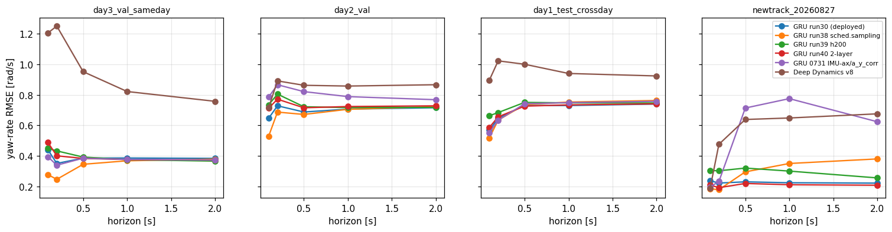

*Yaw-rate error growth with rollout horizon, per dataset.*

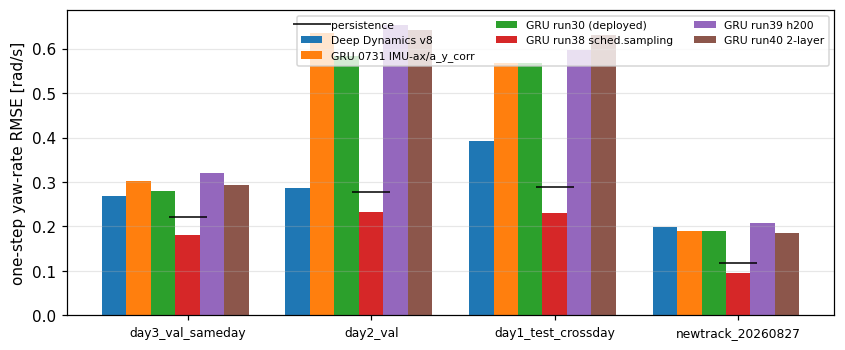

*One-step yaw-rate RMSE per model and dataset; black bars = persistence baseline.*

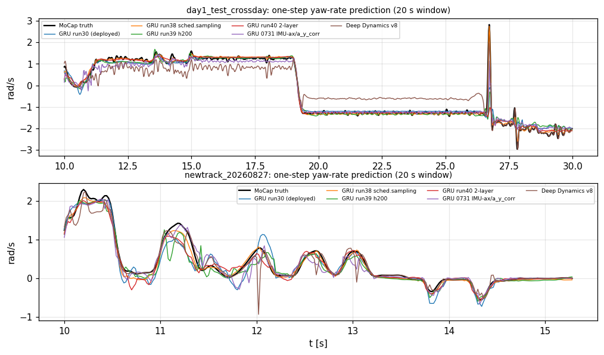

*Predicted vs measured yaw rate (one-step) over a 20 s window.*

### MS-NN (physics-structured) one-step open loop

Inputs: steering, odom speed, IMU a_x/a_y, motor current. Outputs: next yaw rate (IMU) and a_x. Ratio = RMSE / persistence RMSE (below 1 beats repeating the last measurement).

| model | dataset | yaw RMSE | persist | ratio | a_x RMSE | persist | ratio |
|---|---|---|---|---|---|---|---|
| MS-NN exp9 phase2 (deployed) | day3_val_sameday | 0.1398 | 0.1104 | 1.266 | 0.4086 | 0.1495 | 2.732 |
| MS-NN exp9 phase2 (deployed) | day2_val* | 0.1572 | 0.09256 | 1.699 | 0.805 | 0.3362 | 2.394 |
| MS-NN exp9 phase2 (deployed) | day1_test_crossday | 0.1888 | 0.08828 | 2.139 | 1.226 | 0.404 | 3.034 |
| MS-NN exp9 phase2 (deployed) | newtrack_20260827 | 0.2362 | 0.1322 | 1.788 | 0.7415 | 0.282 | 2.63 |
| MS-NN a1 wide-margin phase2 | day3_val_sameday | 0.1452 | 0.1104 | 1.315 | 0.3872 | 0.1495 | 2.59 |
| MS-NN a1 wide-margin phase2 | day2_val* | 0.1439 | 0.09256 | 1.554 | 0.8177 | 0.3362 | 2.432 |
| MS-NN a1 wide-margin phase2 | day1_test_crossday | 0.1831 | 0.08828 | 2.074 | 1.193 | 0.404 | 2.952 |
| MS-NN a1 wide-margin phase2 | newtrack_20260827 | 0.2272 | 0.1322 | 1.719 | 0.7607 | 0.282 | 2.698 |
| MS-NN a2 phase3 lower-lr | day3_val_sameday | 0.1413 | 0.1104 | 1.28 | 0.3626 | 0.1495 | 2.424 |
| MS-NN a2 phase3 lower-lr | day2_val* | 0.159 | 0.09256 | 1.718 | 0.8408 | 0.3362 | 2.501 |
| MS-NN a2 phase3 lower-lr | day1_test_crossday | 0.1912 | 0.08828 | 2.166 | 1.233 | 0.404 | 3.052 |
| MS-NN a2 phase3 lower-lr | newtrack_20260827 | 0.2314 | 0.1322 | 1.751 | 0.7679 | 0.282 | 2.724 |

\* Day-2 file replaced by session_20260722_115055_seg1 (clean IMU, not in MS-NN training).

### Reading the dynamics results

One-step errors near the persistence baseline mean the model mostly reproduces the last state; the rollout curves show how fast errors compound when the model drives itself, which is what matters for closed-loop simulation. Cross-day (Day 1) and new-track results measure generalisation beyond the training sessions.

## Run status

| part | status |
|---|---|
| camera | ok (44 s) |
| lidar | ok (4 s) |
| dynamics | ok (158 s) |
